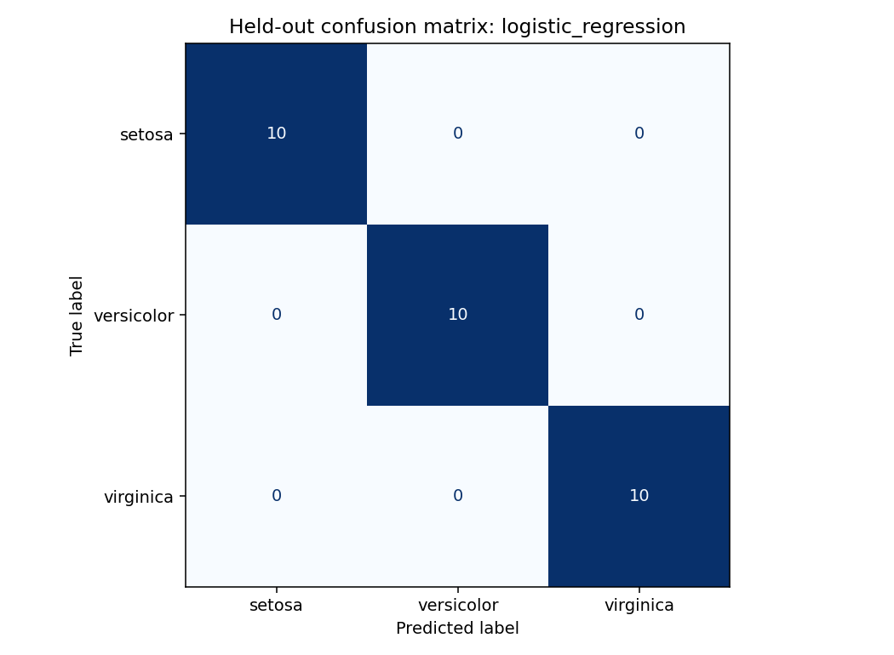

# CodeAlpha — Iris Flower Classification

Classify Iris setosa, versicolor, and virginica from sepal and petal measurements using Python and Scikit-learn. Includes exploratory charts, grouped train/test evaluation, an executed notebook, and reports.

## Run

Python 3.11 or newer is recommended; the recorded run used Python 3.12.14. From this project directory:

```bash
python -m venv .venv
source .venv/bin/activate
python -m pip install -r requirements.txt
python analysis.py
python -m unittest discover -s tests -v
```

The script is noninteractive and uses a headless plotting backend. Its default input and output paths are anchored to `analysis.py`, so it also works when called from another directory. Custom paths are interpreted from the current working directory:

```bash
python analysis.py --data /path/to/Iris.csv --output /path/to/results
```

Open `analysis.ipynb` in a Jupyter-capable editor and run all cells. The notebook calls the same pipeline instead of maintaining a second implementation. Jupyter/IPython are optional notebook tools and are not needed for the CLI. A notebook frontend can be installed separately with `python -m pip install jupyterlab`.

## Data and provenance

The actual analysis input is the user-supplied `data/Iris.csv`. The CodeAlpha task document links to [Kaggle's Iris CSV dataset](https://www.kaggle.com/datasets/saurabh00007/iriscsv); the project does not claim to have independently downloaded or verified that source. No dataset license or independent collection provenance is asserted. Check the original source's applicable terms before further redistribution.

The file has 150 observations, 50 per species, no missing values, and these fields:

| Field | Role |
|---|---|
| `Id` | Record identifier, excluded from model inputs |
| `SepalLengthCm`, `SepalWidthCm` | Numeric predictors, centimetres |
| `PetalLengthCm`, `PetalWidthCm` | Numeric predictors, centimetres |
| `Species` | Target: setosa, versicolor, virginica |

Although there are no identical complete CSV rows, there are three repeated measurement-and-label rows: two extra setosa records in one group and one extra virginica record in another. There are 147 distinct four-feature vectors. They are retained because identical measurements can represent separate flowers; the data do not establish whether these are repeated records. Every identical-feature group stays entirely within one partition and one CV fold. A conflicting label within an identical-feature group causes an explicit error.

## Evaluation design

1. Fix seed 42 and use the first fold of a five-fold shuffled `StratifiedGroupKFold` as an approximately 20% held-out test set. The resulting split is 120 training rows and 30 test rows, with 40/10 per species and no shared measurement groups.
2. Compare a most-frequent baseline with standardized logistic regression, standardized k-nearest neighbours, and standardized RBF SVM using five-fold stratified group-aware cross-validation on the training partition. Scalers are inside pipelines and are fit separately in each training fold.
3. Select hyperparameters by mean CV macro F1; ties within each family follow the declared grid order. Select the best model by mean CV macro F1, then mean CV accuracy, then alphabetical model name. The grids and selection rule are fixed in code.
4. Evaluate the chosen training-fitted estimator once on the held-out data. Evaluate the fixed baseline for context. No held-out score chooses a model or parameter, and no full-data refit is used for the reported results.

| Candidate | Fixed parameter grid |
|---|---|
| Most-frequent baseline | No parameters |
| Logistic regression | `C`: 0.1, 1, 10 |
| K-nearest neighbours | `n_neighbors`: 3, 5, 7 |
| RBF SVM | `C`: 0.1, 1, 10; `gamma="scale"` |

Group constraints can make stratification approximate. The split assignments and fold sizes are saved so this can be audited. Exploratory plots describe the supplied dataset; no choices are made from held-out prediction performance.

## Measured results

The reproducible run selects logistic regression with `C=10`, mean training CV macro F1 **0.9666** (fold standard deviation **0.0312**). Its held-out accuracy and macro F1 are both **1.0000**, with 30/30 correctly classified flowers. Each species has ten test examples. The most-frequent baseline has held-out accuracy **0.3333** and macro F1 **0.1667**.

A perfect score on 30 examples is a limited result from one small, balanced dataset. It does not establish performance on new populations or instruments. Grouping repeated feature vectors prevents direct duplicate overlap but cannot detect undocumented related observations. There is no external validation or deployment testing.



## Outputs and design report

All generated artifacts are under `outputs/` and are refreshed by the CLI or notebook:

| Artifact | Content |
|---|---|
| [`summary.md`](outputs/summary.md) | Design report: objective, data, method, results, limitations, reproducibility |
| [`data_audit.json`](outputs/data_audit.json) | SHA-256, schema, missing values, duplicates, class counts |
| [`metrics.json`](outputs/metrics.json) | Versions, split details, selected parameters, CV summaries, classification report and confusion matrix |
| [`cv_results.csv`](outputs/cv_results.csv) | Every tried model configuration and its training CV results |
| [`split_assignments.csv`](outputs/split_assignments.csv) | Every source row, its measurement group, and training/test assignment |
| [`test_predictions.csv`](outputs/test_predictions.csv) | Held-out measurements, true species, predicted species, correctness |
| `class_distribution.png`, `petal_measurements.png`, `confusion_matrix.png` | Descriptive and evaluation plots |

Tests verify feature-identical observations cannot cross held-out or CV boundaries and that conflicting labels are rejected. They do not assert a fixed accuracy score.

## Report exports

- [Formatted design report](REPORT.md)
- [PDF report](report/report.pdf)
- [Editable DOCX report](report/report.docx)

The committed notebook contains outputs from a successful full execution. The included GitHub Actions workflow reproduces the analysis on Python 3.12. View the Actions tab for the current GitHub run status.

## Submission downloads

- [Complete four-project submission package](https://raw.githubusercontent.com/nisa3131/CodeAlpha_IrisFlowerClassification/main/submission/CodeAlpha_DataScience_Submission.zip)
- [Combined PDF report](https://raw.githubusercontent.com/nisa3131/CodeAlpha_IrisFlowerClassification/main/submission/CodeAlpha_DataScience_Design_Report.pdf) · [Editable Word report](https://raw.githubusercontent.com/nisa3131/CodeAlpha_IrisFlowerClassification/main/submission/CodeAlpha_DataScience_Design_Report.docx)
- [Submission checklist](https://raw.githubusercontent.com/nisa3131/CodeAlpha_IrisFlowerClassification/main/submission/SUBMISSION_CHECKLIST.pdf) · [Video explanation scripts](https://raw.githubusercontent.com/nisa3131/CodeAlpha_IrisFlowerClassification/main/submission/VIDEO_EXPLANATION_SCRIPTS.md)
- [Download this project as a ZIP](https://github.com/nisa3131/CodeAlpha_IrisFlowerClassification/archive/refs/heads/main.zip)

The complete package includes the four projects, executed notebooks, datasets, results, charts, individual reports, the combined report, and submission guidance. The shared downloads are hosted in the Iris repository's `submission/` folder. Record/post the required explanation videos and complete the official submission form separately.
