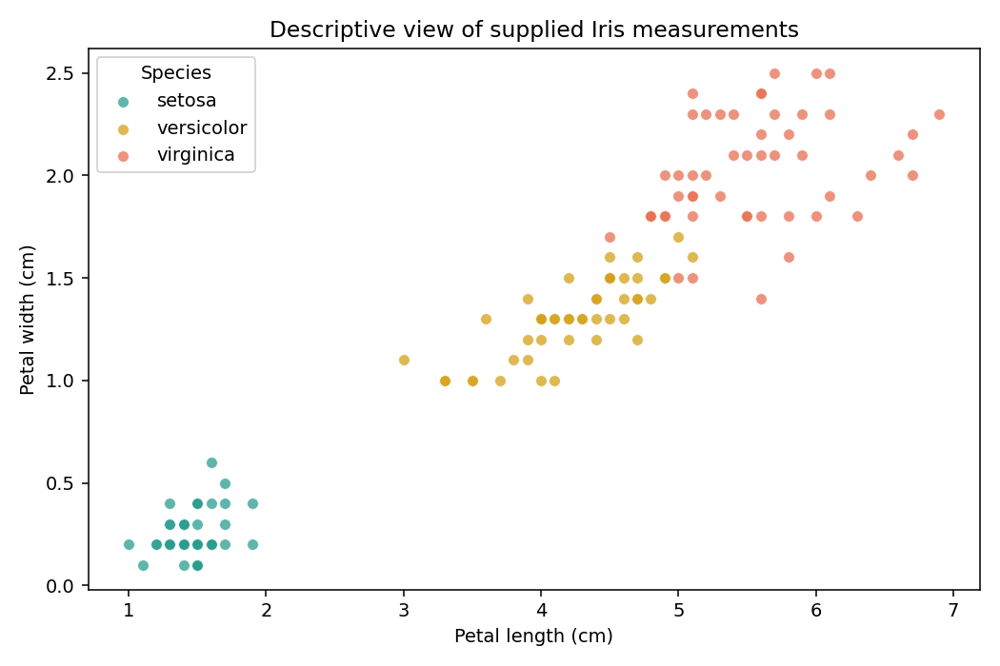

# Iris Flower Classification

**Prepared for:** nisa3131  
**Report date:** 19 October 2026 (Asia/Dhaka)  
**Repository:** `CodeAlpha_IrisFlowerClassification`

This report uses the standard layout approved by the user: objectives, data, method, results, limitations, and reproducibility. All reported findings come from the supplied datasets and executed project analyses.


## 1  Objective

Classify setosa, versicolor, and virginica flowers from sepal length, sepal width, petal length, and petal width. The task covers supervised classification, preprocessing, model comparison, and evaluation on held-out examples.


## 2  Data and provenance

Input: the user-supplied archive.zip, containing Iris.csv. The task document links to https://www.kaggle.com/datasets/saurabh00007/iriscsv. That link is cited as the assignment’s dataset reference; these analyses use the uploaded files rather than a new download. Original collection details and redistribution licensing were not independently verified. No dataset license is asserted.

| Attribute | Observed data / treatment |
| --- | --- |
| Observations | 150; 50 per species |
| Predictors | Four flower measurements in centimetres; Id excluded |
| Data quality | No missing values or duplicate complete rows |
| Repeated measurements | 3 repeated measurement rows; 147 unique measurement groups |
| Duplicate treatment | Retain observations; keep identical measurement groups together in every split |

Identical measurements can represent separate flowers, so they are retained. Their group identity is used for both the train/test partition and cross-validation to prevent the same measurement vector appearing on both sides. No identical measurement group has conflicting species labels.


## 3  Method and evaluation

With random seed 42, the first fold from a shuffled five-fold StratifiedGroupKFold creates 120 training and 30 held-out observations. Each held-out species has 10 examples, and no measurement group crosses the partition. Group constraints make stratification approximate in general.

Four candidates are compared: a most-frequent-class baseline, logistic regression, k-nearest neighbours, and a radial-basis support vector classifier. Numeric scaling is inside each estimator’s pipeline and therefore fit only on the training portion of each fold. Predefined grids are C = 0.1, 1, 10 for logistic regression and SVM, and k = 3, 5, 7 for neighbours.

Training-only, five-fold group-aware cross-validation selects hyperparameters using mean macro F1. Model-level ties use mean CV accuracy and then model name. The winner is fit on the full training partition and evaluated once on the held-out partition. The test score does not choose the model.


## 4  Results and interpretation

| Candidate | CV macro F1<br>mean ± SD | CV accuracy |
| --- | --- | --- |
| logistic regression | 0.9666 ± 0.0312 | 0.9667 |
| knn | 0.9582 ± 0.0264 | 0.9583 |
| rbf svm | 0.9582 ± 0.0264 | 0.9583 |
| dummy most frequent | 0.1667 ± 0.0000 | 0.3333 |

*Training cross-validation scores. The standard deviation describes variation across five folds, not a confidence interval.*

**Selected model: logistic regression (C = 10).** Its mean CV macro F1 is 0.9666. Held-out accuracy and macro F1 are 1.000 and 1.000, respectively. The most-frequent baseline reaches 0.333 accuracy and 0.167 macro F1.

| Species | Test n | Precision | Recall | F1 |
| --- | --- | --- | --- | --- |
| setosa | 10 | 1.000 | 1.000 | 1.000 |
| versicolor | 10 | 1.000 | 1.000 | 1.000 |
| virginica | 10 | 1.000 | 1.000 | 1.000 |



*Figure 1. Descriptive petal measurements in the supplied dataset. Setosa is visibly separated; versicolor and virginica overlap more.*


*Figure 2. Held-out confusion matrix for the CV-selected model. All 30 test observations are correctly classified in this split.*


## 5  Limitations and next steps

- A perfect score on 30 held-out examples has substantial sampling uncertainty. It does not establish performance on flowers from new locations, instruments, or populations.
- Grouping identical vectors reduces direct duplicate leakage; unrecorded biological or collection relationships may still remain.
- The labels and measurements are not independently verified. This is an educational model, with no external validation or deployment assessment.
- The next evaluation should use an independently collected, well-documented flower dataset and report uncertainty before relying on predictions operationally.


## 6  Reproducibility

Validation recorded on 19 October 2026: the delivered notebook executed 4 code cells with 0 recorded errors. The analysis pipeline and its built-in data/evaluation checks completed successfully. The project’s 2 unit tests also passed.

Install the pinned requirements and rerun from the repository root. The notebook calls the same analysis pipeline.

```bash
python -m venv .venv
. .venv/bin/activate
python -m pip install -r requirements.txt
python analysis.py
python -m unittest discover -s tests -v
```

outputs/metrics.json records versions, split sizes, selected parameters, and per-class evaluation. outputs/data_audit.json records the source SHA-256 and quality checks. split_assignments.csv and cv_results.csv expose group membership and every tried configuration; test_predictions.csv records held-out outcomes. The final estimator is fit on training data only.
